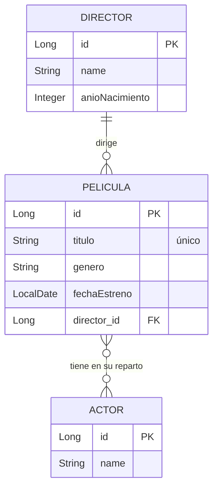

# Gestión de Películas - API REST con Spring Boot

Gestión de Películas es una API REST que permite gestionar un catálogo de películas, sus directores y el reparto de actores. Incluye validación de entradas, una anotación de validación personalizada, gestión de errores mediante `ProblemDetail` y documentación interactiva con OpenAPI 3 y Swagger UI.

Proyecto individual de **Acceso a Datos** y **Programación de Servicios y Procesos** (curso 2026-27).

---

# Índice

1. [Funcionalidades del Sistema](#funcionalidades-del-sistema)
2. [Tecnologías Utilizadas](#tecnologías-utilizadas)
3. [Modelo de Datos](#modelo-de-datos)
4. [Estructura del Proyecto](#estructura-del-proyecto)
5. [Configuración y Persistencia](#configuración-y-persistencia)
6. [Puesta en Marcha](#puesta-en-marcha)
   - [Requisitos Previos](#requisitos-previos)
   - [Instrucciones de Ejecución](#instrucciones-de-ejecución)
7. [Documentación de la API (Swagger)](#documentación-de-la-api-swagger)
8. [Endpoints](#endpoints)
9. [Validaciones](#validaciones)
10. [Gestión de Errores](#gestión-de-errores)
11. [Probar la API](#probar-la-api)

---

## Funcionalidades del Sistema

- **Directores**
  - CRUD completo: crear, listar, consultar por id, actualizar y borrar.
  - No se puede borrar un director que tenga películas asociadas (error `409 Conflict`).

- **Películas**
  - CRUD completo: crear, listar, consultar por id, actualizar y borrar.
  - Al crear una película es obligatorio indicar el id de un director existente.
  - El título es único: no se pueden crear dos películas con el mismo título.
  - Un director debe ser mayor de edad para lanzar una película (validación personalizada).

- **Actores**
  - CRUD básico: crear, listar y consultar por id.

- **Reparto (relación Muchos a Muchos)**
  - Asignación de un actor a una película.
  - Consulta de una película con su director y la lista completa de su reparto.
  - Un mismo actor no puede asignarse dos veces a la misma película.

---

## Tecnologías Utilizadas

| Categoría | Tecnología |
|------------|------------|
| Lenguaje | Java 21 |
| Framework Back-End | Spring Boot 4.1.1 |
| Persistencia / ORM | Spring Data JPA + Hibernate |
| Base de Datos | H2 (modo archivo) |
| Validación | Jakarta Bean Validation (`spring-boot-starter-validation`) |
| Documentación | springdoc-openapi 3.1.1 (OpenAPI 3 + Swagger UI) |
| Utilidades | Lombok |
| Pruebas de la API | Postman y archivo `.http` |
| Gestor de Dependencias | Maven (Wrapper incluido) |

---

## Modelo de Datos

El modelo está formado por tres entidades. Un director dirige muchas películas (relación 1:N) y una película tiene muchos actores, igual que un actor participa en muchas películas (relación M:M).



| Entidad | Campo | Tipo | Observaciones |
|---------|-------|------|---------------|
| **Director** | `id` | Long | Clave primaria autogenerada |
| | `name` | String | Nombre del director |
| | `anioNacimiento` | Integer | Año de nacimiento |
| **Pelicula** | `id` | Long | Clave primaria autogenerada |
| | `titulo` | String | Único |
| | `genero` | String | |
| | `fechaEstreno` | LocalDate | Formato `yyyy-MM-dd` |
| | `director` | Director | Relación `@ManyToOne` |
| | `actores` | Set\<Actor\> | Relación `@ManyToMany` |
| **Actor** | `id` | Long | Clave primaria autogenerada |
| | `name` | String | Nombre del actor o actriz |

### DTOs

Las entidades no se exponen directamente. Cada recurso tiene un DTO de entrada para crear (`Edit...Dto`), otro para actualizar (`Update...Dto`, solo en director y película) y otro de salida (`Get...Detail`). La respuesta de una película usa **DTOs anidados**: contiene un `GetDirectorSimple` y una lista de `GetActorDetail`.

---

## Estructura del Proyecto

El proyecto Maven está dentro de la carpeta `Gestion de peliculas`:

```text
Gestion de peliculas/
├── pom.xml
├── mvnw
├── mvnw.cmd
└── src/
    └── main/
        ├── java/com/salesianos/dam/gestiondepeliculas/
        │   ├── controller/        # Controladores REST y documentación OpenAPI
        │   ├── dto/               # DTOs de entrada y salida (actor, director, pelicula)
        │   ├── error/             # Excepciones personalizadas y manejador global
        │   │   └── noEncontrado/  # Excepciones 404 de película, director y actor
        │   ├── model/             # Entidades JPA
        │   ├── repository/        # Repositorios Spring Data JPA
        │   ├── service/           # Lógica de negocio
        │   ├── validacion/        # Anotación de validación personalizada
        │   └── GestionDePeliculasApplication.java
        │
        └── resources/
            ├── application.properties
            └── test.http          # Peticiones de prueba
```

---

## Configuración y Persistencia

El comportamiento del servidor y de la base de datos se configura en:

```text
Gestion de peliculas/src/main/resources/application.properties
```

### Properties

```properties
spring.application.name=Gestion de peliculas

spring.jpa.show-sql=true

spring.datasource.url=jdbc:h2:./db/basedatos
spring.datasource.username=sa
spring.datasource.password=
spring.h2.console.enabled=true
spring.jpa.hibernate.ddl-auto=create-drop

logging.level.org.springframework.web=TRACE
```

### Nota de Desarrollo

La base de datos H2 se guarda en un archivo local:

```text
./db/basedatos
```

Al utilizar:

```properties
spring.jpa.hibernate.ddl-auto=create-drop
```

el esquema se elimina y se vuelve a crear en cada arranque, por lo que **la aplicación siempre empieza con la base de datos vacía**. Además, `show-sql` muestra por consola las consultas SQL y el nivel de log `TRACE` de `org.springframework.web` detalla el procesamiento de cada petición.

El servidor usa el puerto por defecto de Spring Boot, el `8080`.

---

## Puesta en Marcha

### Requisitos Previos

- Java 21 o superior.
- Terminal compatible con Maven Wrapper (`mvnw`).

No hace falta instalar ninguna base de datos: la aplicación utiliza H2 embebida.

### Instrucciones de Ejecución

#### 1. Clonar el repositorio

```bash
git clone https://github.com/francisco-aguilar04/Gestion-de-peliculas.git
cd Gestion-de-peliculas
cd "Gestion de peliculas"
```

#### 2. Lanzar la aplicación

Desde dentro de la carpeta `Gestion de peliculas`:

##### Linux / macOS

```bash
./mvnw spring-boot:run
```

##### Windows

```cmd
mvnw.cmd spring-boot:run
```

#### 3. Acceder a la aplicación

La API queda disponible en:

```text
http://localhost:8080
```

**Consola H2**

```text
http://localhost:8080/h2-console
```

Asegúrese de utilizar la siguiente URL JDBC, con el usuario `sa` y la contraseña vacía:

```text
jdbc:h2:./db/basedatos
```

> **Nota:** los datos se eliminan en cada arranque (`create-drop`), por lo que siempre se parte de una base de datos vacía.

---

## Documentación de la API (Swagger)

Con la aplicación arrancada, la documentación interactiva generada con OpenAPI 3 está disponible en:

| Recurso | URL |
|---------|-----|
| **Swagger UI** | `http://localhost:8080/swagger-ui/index.html` |
| **Especificación OpenAPI (JSON)** | `http://localhost:8080/v3/api-docs` |

Cada endpoint está documentado con su descripción, ejemplos de respuesta y todos sus códigos de error, incluidos los del endpoint de asignación de reparto.

---

## Endpoints

### Directores - `/api/v1/director`

| Método | Ruta | Descripción | Códigos |
|--------|------|-------------|---------|
| `POST` | `/api/v1/director` | Crear un director | 201, 400 |
| `GET` | `/api/v1/director` | Listar todos los directores | 200, 404 |
| `GET` | `/api/v1/director/{id}` | Obtener un director por id | 200, 400, 404 |
| `PUT` | `/api/v1/director/{id}` | Actualizar un director | 200, 400, 404 |
| `DELETE` | `/api/v1/director/{id}` | Borrar un director (solo si no tiene películas asociadas) | 204, 409 |

### Actores - `/api/v1/actor`

| Método | Ruta | Descripción | Códigos |
|--------|------|-------------|---------|
| `POST` | `/api/v1/actor` | Crear un actor | 201, 400 |
| `GET` | `/api/v1/actor` | Listar todos los actores | 200, 404 |
| `GET` | `/api/v1/actor/{id}` | Obtener un actor por id | 200, 400, 404 |

### Películas - `/api/v1/peliculas`

| Método | Ruta | Descripción | Códigos |
|--------|------|-------------|---------|
| `POST` | `/api/v1/peliculas` | Crear una película | 201, 400, 404, 409 |
| `GET` | `/api/v1/peliculas` | Listar todas las películas | 200, 404 |
| `GET` | `/api/v1/peliculas/{id}` | Obtener una película con su director y su reparto | 200, 400, 404 |
| `PUT` | `/api/v1/peliculas/{id}` | Actualizar una película | 200, 400, 404, 409 |
| `DELETE` | `/api/v1/peliculas/{id}` | Borrar una película | 204 |
| `POST` | `/api/v1/peliculas/{peliculaId}/actores/{actorId}` | Asignar un actor al reparto de una película | 200, 404, 409 |

### Notas sobre los endpoints

- Los `PUT` de director y de película son **actualizaciones parciales**: solo se modifican los campos que se envían en el cuerpo.
- Los `DELETE` son **idempotentes**: devuelven `204 No Content` aunque el recurso ya no exista.
- Un director **no se puede borrar si tiene películas asociadas**: la API responde `409 Conflict`. Hay que borrar antes sus películas.
- Los listados devuelven `404` cuando todavía no hay ningún registro.
- Los ids de las rutas de consulta (`GET`) deben ser mayores o iguales que 1.

### Ejemplos

**Crear una película** - `POST /api/v1/peliculas`

```json
{
  "titulo": "El laberinto del fauno",
  "genero": "Fantasía",
  "fechaEstreno": "2006-10-11",
  "directorId": 1
}
```

**Respuesta** - `201 Created`

```json
{
  "id": 1,
  "titulo": "El laberinto del fauno",
  "director": {
    "id": 1,
    "name": "Guillermo del Toro"
  },
  "actores": []
}
```

**Asignar un actor** - `POST /api/v1/peliculas/1/actores/1`

Sin cuerpo. Devuelve la película con el reparto actualizado:

```json
{
  "id": 1,
  "titulo": "El laberinto del fauno",
  "director": {
    "id": 1,
    "name": "Guillermo del Toro"
  },
  "actores": [
    {
      "id": 1,
      "name": "Ivana Baquero"
    }
  ]
}
```

---

## Validaciones

Las validaciones se aplican con Jakarta Bean Validation sobre los DTOs de entrada de los `POST` y de los `PUT`. Los `POST` usan los DTOs `Edit...Dto`, con todos los campos obligatorios. Los `PUT` usan los DTOs `Update...Dto`, cuyos campos son opcionales: solo se validan los que se envían.

#### Creación (`POST`)

| DTO | Campo | Reglas |
|-----|-------|--------|
| `EditDirectorDto` | `name` | Obligatorio, máximo 100 caracteres |
| | `anioNacimiento` | Obligatorio, mínimo 1850 |
| `EditActorDto` | `name` | Obligatorio, máximo 100 caracteres |
| `EditPeliculaDto` | `titulo` | Obligatorio, máximo 150 caracteres |
| | `genero` | Obligatorio, máximo 50 caracteres |
| | `fechaEstreno` | Obligatoria |
| | `directorId` | Obligatorio, mínimo 1, director mayor de edad |

#### Actualización (`PUT`)

| DTO | Campo | Reglas (si se envía) |
|-----|-------|----------------------|
| `UpdateDirectorDto` | `name` | No puede estar vacío, máximo 100 caracteres |
| | `anioNacimiento` | Mínimo 1850 |
| `UpdatePeliculaDto` | `titulo` | No puede estar vacío, máximo 150 caracteres |
| | `genero` | No puede estar vacío, máximo 50 caracteres |
| | `fechaEstreno` | Formato `yyyy-MM-dd` |

El `PUT` de película no permite cambiar el director.

### Anotación personalizada: `@DirectorMayoriaEdad`

Se aplica sobre `directorId` en `EditPeliculaDto`. Comprueba que el director indicado tenga **al menos 18 años** para poder lanzar una película, calculando la edad a partir de su año de nacimiento. Si el director no cumple la regla, la petición se rechaza con `400 Bad Request`.

Si el id es nulo o el director no existe, esta validación no interviene: de eso se encargan `@NotNull` y el servicio, que responde con `404`.

---

## Gestión de Errores

Todos los errores se devuelven en formato `ProblemDetail` (RFC 9457), gestionados desde `GlobalExceptionHandler`.

| Excepción | Código | Cuándo se lanza |
|-----------|--------|-----------------|
| `PeliculaNoEncontradaException` | **404** | La película no existe, o no hay ninguna registrada |
| `DirectorNoEncontradoException` | **404** | El director no existe, o no hay ninguno registrado |
| `ActorNoEncontradoException` | **404** | El actor no existe, o no hay ninguno registrado |
| `PeliculaYaExistenteException` | **409** | Se crea o actualiza una película con un título que ya existe |
| `ActorYaEnRepartoException` | **409** | Se asigna un actor que ya está en el reparto de la película |
| `DirectorConPeliculasException` | **409** | Se intenta borrar un director que tiene películas asociadas |
| Error de validación | **400** | Algún campo del cuerpo incumple las reglas de validación |

Se usa **409 Conflict** para los duplicados porque la petición es correcta pero choca con un recurso que ya existe.

### Ejemplo de error 409

```json
{
  "type": "https://example.com/errors/conflict",
  "title": "El actor ya está en el reparto",
  "status": 409,
  "detail": "El actor de id 1 ya está en el reparto de la película",
  "instance": "/api/v1/peliculas/1/actores/1"
}
```

### Ejemplo de error 409 al borrar un director con películas

`DELETE /api/v1/director/1`

```json
{
  "type": "https://example.com/errors/conflict",
  "title": "El director tiene películas asociadas",
  "status": 409,
  "detail": "No se puede borrar el director de id 1 porque está asociado a una o más películas.",
  "instance": "/api/v1/director/1"
}
```

### Ejemplo de error 400 (validación)

Los errores de validación incluyen la lista de campos incorrectos en `invalid-params`:

```json
{
  "type": "about:blank",
  "title": "Bad Request",
  "status": 400,
  "detail": "Error de validación",
  "instance": "/api/v1/director",
  "invalid-params": [
    {
      "object": "editDirectorDto",
      "message": "El nombre del director es obligatorio",
      "field": "name",
      "rejectedValue": ""
    }
  ]
}
```

---

## Probar la API

El repositorio incluye dos formas de probar todos los endpoints, con casos correctos y casos de error (400, 404 y 409):

- **Colección de Postman:** `Gestión de cine.postman_collection.json`. Se importa desde Postman con *Import*.
- **Archivo HTTP:** `Gestion de peliculas/src/main/resources/test.http`. Se puede ejecutar directamente desde IntelliJ IDEA.

### Orden recomendado para una prueba rápida

1. Crear un director: `POST /api/v1/director`.
2. Crear una película con ese director: `POST /api/v1/peliculas`.
3. Crear un actor: `POST /api/v1/actor`.
4. Asignar el actor a la película: `POST /api/v1/peliculas/1/actores/1`.
5. Consultar la película con su reparto: `GET /api/v1/peliculas/1`.

Los ids de los ejemplos (`1`) asumen una base de datos recién arrancada.

---

## Resumen

Gestión de Películas es una API REST basada en Spring Boot que incorpora:

- CRUD completo de directores y películas, y CRUD básico de actores.
- Relación Muchos a Muchos entre películas y actores con asignación de reparto.
- Validación de entradas con anotaciones estándar y una anotación personalizada.
- Gestión de errores con `ProblemDetail` y excepciones propias.
- DTOs anidados para no exponer las entidades.
- Documentación OpenAPI 3 con Swagger UI.
- Colección de Postman y archivo `.http` para probar la API.

---

## Autor

Francisco Aguilar  
GitHub: [francisco-aguilar04](https://github.com/francisco-aguilar04)